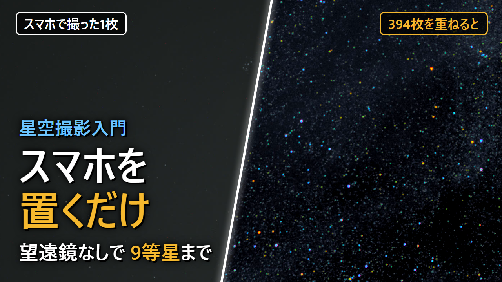
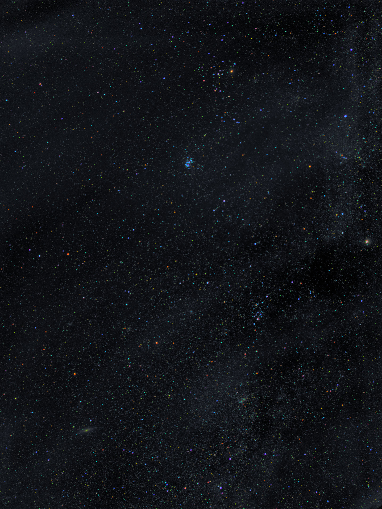
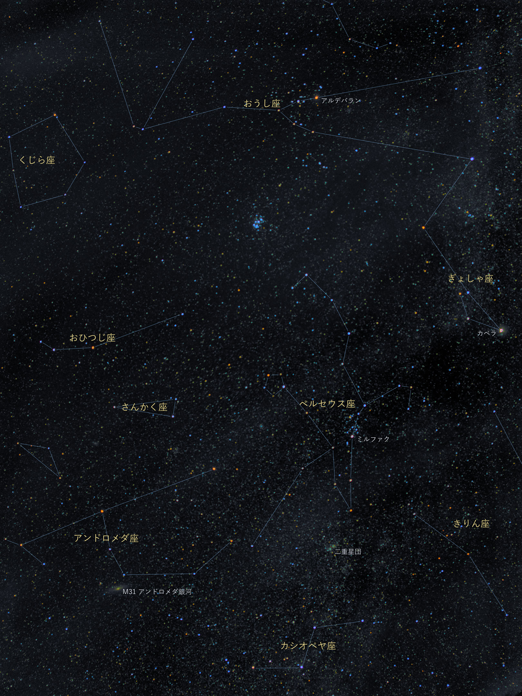

# starstack

三脚などに固定したスマホで連写した RAW(DNG)から、星に位置を合わせて重ねた星空の写真を作るプログラムです。望遠鏡も、星を追いかける機械も使いません。

- 入力: 同じ構図で撮り続けた DNG の連写(12枚以上)。Pixel 11 Pro と Open Camera で撮ったもので確認しています。
- 出力: 星に合わせて重ねた画像、星の軌跡、星座線と名前を入れた画像、2倍解像度の画像(JPEG と 16bit TIFF)。
- 処理の中身は [PROCESSING.md](PROCESSING.md) にまとめています。
- 解説動画: [星空撮影入門 スマホを外に放置するだけで星空を撮る](https://youtu.be/gi0ALoWkri0?t=0s)

## 作例

16秒露光の写真394枚(約2時間)から作ったものです。左が撮ったままの1枚、右が重ねた結果です。



| 重ねた結果 | 星座線と名前を入れたもの |
|---|---|
|  |  |

## 撮り方

1. スマホを空に向けて固定します。長時間になるので、充電しながらが安心です。
2. [Open Camera](https://opencamera.org.uk/) で次のように設定します。
   - 保存形式: DNG (RAW) only
   - シャッター速度: 16秒
   - ISO: 機種に合わせて調整(目安は 100〜800。ヒストグラムの山が左端から少し離れる程度)
   - フォーカス: 手動で無限遠
   - 連続撮影: 無制限、タイマー: 5秒
3. シャッターを押して、そのまま置いておきます。

月のない晴れた夜に、街の明かりから離れた場所で撮ると、暗い星まで写ります。

## ビルド

Rust(cargo)が必要です。

```
cd starstack
cargo build --release
```

## 使い方

```
starstack <RAWフォルダ> <出力フォルダ> [ダークフォルダ] [オプション]
```

例:

```
starstack raw_data output dark_frame --catalog=catalog --2x
```

- ダークフォルダ(任意): レンズをふさいで同じ設定で撮った DNG。ホットピクセルの検出に使います。
- `--catalog=フォルダ`: 恒星カタログの場所。あれば星座線と名前を入れた画像も出します。
- `--2x`: 2倍解像度の画像も出します(メモリを約15GB余分に使います)。

全フレームをメモリに読み込むので、12MP の DNG 400枚で 10GB ほど使います。オプションの一覧は [PROCESSING.md](PROCESSING.md) の10章にあります。

## 恒星カタログ

`catalog/` の `stars.6.json`、`stars.8.json`、`constellations.lines.json` は [d3-celestial](https://github.com/ofrohn/d3-celestial)(BSD 3-Clause License、Copyright (c) 2015, Olaf Frohn)のデータです。

## 解説動画

`video/` は、このプログラムの[解説動画](https://youtu.be/gi0ALoWkri0?t=0s)(台本、音声合成、アニメーション)を [Remotion](https://www.remotion.dev/) で作るためのプロジェクトです。音声は VOICEVOX(四国めたん、春日部つむぎ)で合成します。BGM・効果音・撮影データはリポジトリに含めていません。Remotion には独自のライセンスがあり、利用条件は Remotion の案内を確認してください。

```
cd video
npm install
node tools/make_assets.mjs --stack   # 素材を作る(撮影データと starstack のビルドが必要)
node tools/build_timeline.mjs        # 音声とタイムラインを作る(VOICEVOX エンジンを起動しておく)
npm run render                       # out/main.mp4 に書き出す
```

## ライセンス

[MIT License](LICENSE)
